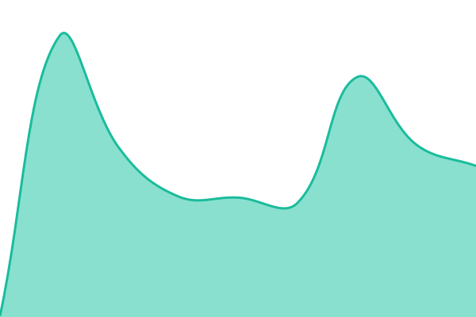
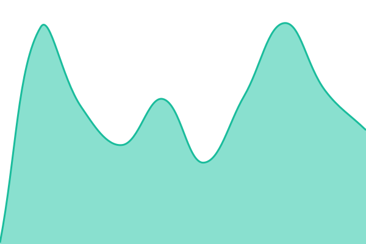

# [📈 Status nå](https://status.hofstad.net): <!--live status--> **Alt virker som det skal**

This repository contains the open-source uptime monitor and status page for [HofstadNET](https://hofstad.net), powered by [Upptime](https://github.com/upptime/upptime).

With [Upptime](https://upptime.js.org), you can get your own unlimited and free uptime monitor and status page, powered entirely by a GitHub repository. We use [Issues](https://github.com/hofstadnet/status/issues) as incident reports, [Actions](https://github.com/hofstadnet/status/actions) as uptime monitors, and [Pages](https://status.hofstad.net) for the status page.

## [📈 Live Status](https://demo.upptime.js.org): <!--live status--> **Alt virker som det skal**

<!--start: status pages-->
<!-- This summary is generated by Upptime (https://github.com/upptime/upptime) -->
<!-- Do not edit this manually, your changes will be overwritten -->
<!-- prettier-ignore -->
| URL | Status | History | Response Time | Uptime |
| --- | ------ | ------- | ------------- | ------ |
|  [hofstad.net](https://hofstad.net/) | 🟩 Up | [hofstad-net.yml](https://github.com/hofstadnet/status/commits/HEAD/history/hofstad-net.yml) | 

 213ms
     
 | 

<a href="https://status.hofstad.net/history/hofstad-net">100.00%</a>
    

|  [Flystatus (API)](https://hofstad.net/api/status) | 🟩 Up | [flystatus-api.yml](https://github.com/hofstadnet/status/commits/HEAD/history/flystatus-api.yml) | 

 790ms
     
 | 

<a href="https://status.hofstad.net/history/flystatus-api">100.00%</a>
    

|  [Søk](https://hofstad.net/pagefind/pagefind.js) | 🟩 Up | [sok.yml](https://github.com/hofstadnet/status/commits/HEAD/history/sok.yml) | 

 131ms
     
 | 

<a href="https://status.hofstad.net/history/sok">100.00%</a>
    

|  [RSS](https://hofstad.net/rss.xml) | 🟩 Up | [rss.yml](https://github.com/hofstadnet/status/commits/HEAD/history/rss.yml) | 

 125ms
     
 | 

<a href="https://status.hofstad.net/history/rss">100.00%</a>
    

<!--end: status pages-->

[**Visit our status website →**](https://status.hofstad.net)

## 📄 License

- Powered by: [Upptime](https://github.com/upptime/upptime)
- Code: [MIT](./LICENSE) © [Anand Chowdhary](https://anandchowdhary.com)
- Data in the `./history` directory: [Open Database License](https://opendatacommons.org/licenses/odbl/1-0/)
